# CodeCrew

English | [中文](README.zh.md)



CodeCrew is a coding-focused fork of [DeepSeek Harness](https://github.com/deepseek-ai/deepseek-harness). It combines editable model profiles, supervised agents, automatic skill selection, and general and workspace memory.

- Choose global defaults and separate reader, implementer, planner, reviewer, and decision advisor models in Settings → Coding.
- Handle small changes directly. Delegate substantial work with scoped task briefs, dependencies, concurrent workers, and supervisor verification.
- Load relevant skills through local rules and restore retained memory snapshots after session compaction.
- Ask the optional OpenRouter Jev advisor bounded questions, including questions about retained image attachments.

<a id="run"></a>

<a id="run-from-source"></a>

## Run from source

Use the latest stable Bun and Node.js 24.9 or newer. Bun manages dependencies and scripts; Node and Electron run the existing application and native addons.

```sh
git clone https://github.com/daraHK88/CodeCrew.git
cd CodeCrew
bun install --frozen-lockfile
bun run build
node coding/setup.mjs
DSH_HOME="$PWD/.coding-home" node --import tsx/esm apps/cli/src/bin.ts coding --no-open
```

Open the authenticated URL printed by the launcher. See the [setup guide](coding/README.md) for the desktop app, providers, memory, and model routing. Local settings and sessions live in the ignored `.coding-home` directory.

There is no published CodeCrew npm package or standalone installer. Provider authentication must be configured before using its models; supported login methods depend on the provider. Review the [safety notice](SAFETY.md) before running coding agents.

## Development

The project retains upstream package names and its Cordis plugin architecture. Start with the [development guide](docs/development.md), [architecture](docs/architecture.md), and [agent instructions](AGENTS.md). Report CodeCrew issues in [this repository](https://github.com/daraHK88/CodeCrew/issues).

## License and attribution

[MIT](LICENSE). CodeCrew builds on DeepSeek AI's DeepSeek Harness and retains its copyright notices. Third-party licenses are listed in [THIRD_PARTY_NOTICES.md](THIRD_PARTY_NOTICES.md).
