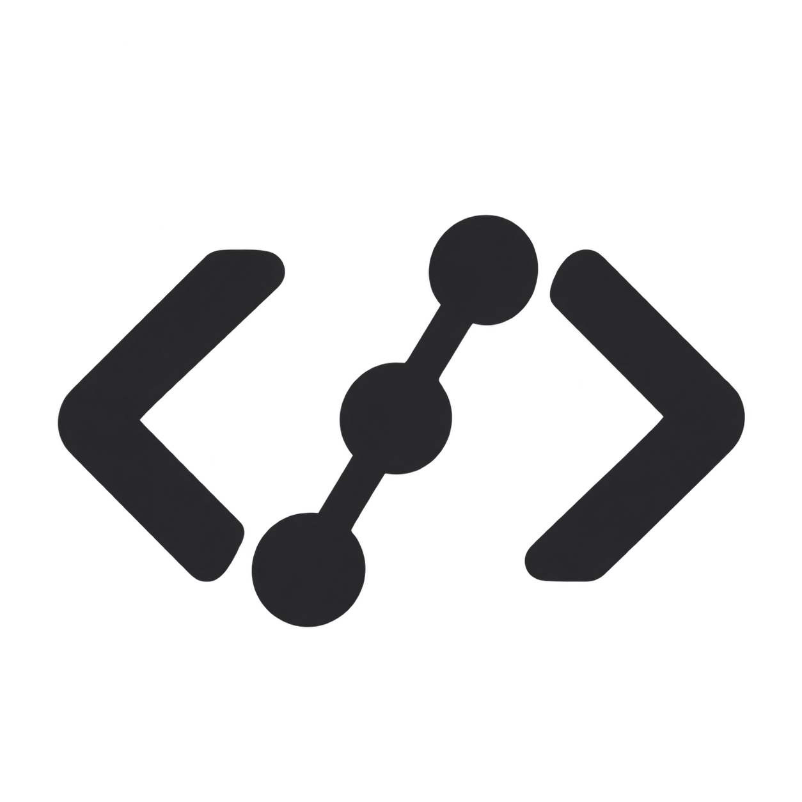

# CodeCrew

[English](README.md) | 中文



CodeCrew 是专注编码的 [DeepSeek Harness](https://github.com/deepseek-ai/deepseek-harness) fork，提供可编辑模型配置、主管协调的 agent、自动技能选择，以及通用和工作区记忆。

- 在 Settings → Coding 选择全局默认模型，以及独立的 reader、implementer、planner、reviewer 和决策顾问模型。
- 小改动直接执行；复杂工作使用限定范围的任务描述、依赖关系、并行 worker 和主管验证。
- 通过本地规则加载相关技能，在会话压缩后恢复保留的记忆快照。
- 可选 OpenRouter Jev 顾问回答有预算限制的问题，包括保留图像附件相关问题。

<a id="run"></a>

<a id="run-from-source"></a>

## 从源码运行

使用 Node.js 24.9 或更新版本，以及 `package.json` 声明的 pnpm 版本。

```sh
git clone https://github.com/daraHK88/CodeCrew.git
cd CodeCrew
pnpm install --frozen-lockfile
pnpm run build
node coding/setup.mjs
DSH_HOME="$PWD/.coding-home" node --import tsx/esm apps/cli/src/bin.ts coding --no-open
```

打开启动器打印的认证网址。桌面应用、提供方、记忆和模型路由详见[设置指南](coding/README.zh.md)。本地设置和会话保存在已忽略的 `.coding-home` 目录。

CodeCrew 尚无已发布的 npm 包或独立安装器。使用模型前须配置提供方认证，登录方式取决于各提供方。运行编码 agent 前请阅读[安全说明](SAFETY.zh.md)。

## 开发

项目保留上游包名和 Cordis 插件架构。请先阅读[开发指南](docs/development.zh.md)、[架构文档](docs/architecture.zh.md)和 [agent 指令](AGENTS.md)。CodeCrew 问题请提交至[本仓库](https://github.com/daraHK88/CodeCrew/issues)。

## 许可证与致谢

[MIT](LICENSE)。CodeCrew 基于 DeepSeek AI 的 DeepSeek Harness，保留其版权声明。第三方许可证见 [THIRD_PARTY_NOTICES.md](THIRD_PARTY_NOTICES.md)。
